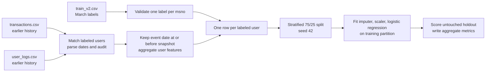

# Features and pipeline

This guide describes the implemented baseline at source commit `052d4b5a977e118025a81523dd7c608631d2a673`. The [evaluation protocol](DATA_AND_EVALUATION.md) explains what its holdout can and cannot establish.

## Data flow

The code joins event rows to labeled users by `msno`, then counts matched rows with invalid dates or dates after the requested snapshot separately. These rows do not enter model features. The normal training run requires at least one matching pre-snapshot row from each selected event source. `--audit-only` relaxes that coverage check so a wrong file version can still be diagnosed.

## Input contract

| CSV | Required fields used here | Purpose |
| --- | --- | --- |
| `train_v2.csv` | `msno`, `is_churn` | Unique, nonempty user ID and binary target (0 or 1) |
| `transactions.csv` | `msno`, `transaction_date`, `actual_amount_paid`, `payment_plan_days`, `is_auto_renew` | Transaction history; date format `YYYYMMDD` |
| `user_logs.csv` | `msno`, `date`, `total_secs`, `num_unq` | Listening history; date format `YYYYMMDD` |

The intended cutoff is `2017-02-28`. The `_v2` event files are March updates and are unsuitable for this cutoff. `members_v3.csv` is excluded because its historical state at the cutoff is unproven. The source files have no ingestion timestamp, so event-date filtering alone cannot establish operational availability at the decision time.

## Derived feature dictionary

All aggregates are calculated for each labeled user from **matched rows with valid event dates on or before the snapshot**. The model drops `msno` and `is_churn` from the input matrix.

| Model column | Definition | No matching history |
| --- | --- | --- |
| `transaction_count` | Number of eligible transaction rows | `0` |
| `total_paid` | Sum of `actual_amount_paid` over eligible transactions | `0` |
| `last_transaction_days` | Snapshot date minus latest eligible transaction date, in calendar days | `-1` |
| `last_plan_days` | `payment_plan_days` from the chosen latest transaction row | `0` |
| `last_auto_renew` | `is_auto_renew` from that same chosen transaction row | `0` |
| `log_rows` | Number of eligible listening rows; no assumption that there is exactly one row per user-day | `0` |
| `total_listening_seconds` | Sum of `total_secs` over eligible listening rows | `0` |
| `total_unique_tracks` | Sum of the source `num_unq` values; this is **not** a distinct count across days | `0` |
| `last_log_days` | Snapshot date minus latest eligible listening date, in calendar days | `-1` |

For the measured DuckDB run, ties on the latest transaction date are resolved by greater `payment_plan_days`, then greater `is_auto_renew`. Both latest fields therefore come from one selected row. The Python streaming engine uses the last row in file order on same-date ties; its scores may differ. Use `--engine duckdb` for the published result. Empty numeric cells are treated as zero; invalid numeric values in matched, pre-snapshot rows cause the DuckDB engine to stop. The `-1` recency marker and zero counts combine absent history with potentially incomplete collection; they do not distinguish those cases.

## Training and outputs

`src/kkbox_churn/cli.py` selects the DuckDB or Python feature builder. The full-data run uses `src/kkbox_churn/duckdb_features.py`, which sets DuckDB to four threads and an 8 GB memory limit and writes `feature_cache.duckdb` under the selected output directory. The Python implementation in `features.py` reads CSV rows sequentially. Both return one feature row per label and aggregate audit counts.

`src/kkbox_churn/model.py` creates a scikit-learn pipeline: median imputation, standard scaling, and logistic regression (`max_iter=1000`). The random 25% holdout is stratified by label with seed 42. All fitted preprocessing uses the training portion only. The CLI writes aggregate `metrics.json` plus a local `baseline.joblib`; `--audit-only` writes `audit.json` without fitting. The baseline is an experiment, not an inference API or a deployment artifact.

## Evaluation boundaries

The model's target is the competition's supplied `is_churn`, not a reconstructed business definition. The holdout samples users from that same March-label cohort. It cannot estimate performance on a later cohort, prove probability calibration in production, establish a causal retention effect, or select an outreach threshold. See [RESULTS.md](RESULTS.md) for the measured numbers and remaining validation work.
